# Screenshots and recording

**Screen recording:** [demo-recording.webm](demo-recording.webm) is a scripted walkthrough: sign-up, validation errors, add/edit/delete, the per-day rules, and the reports. It opens in Chrome, Edge or Firefox.

| | |
| --- | --- |
| Sign-up validation 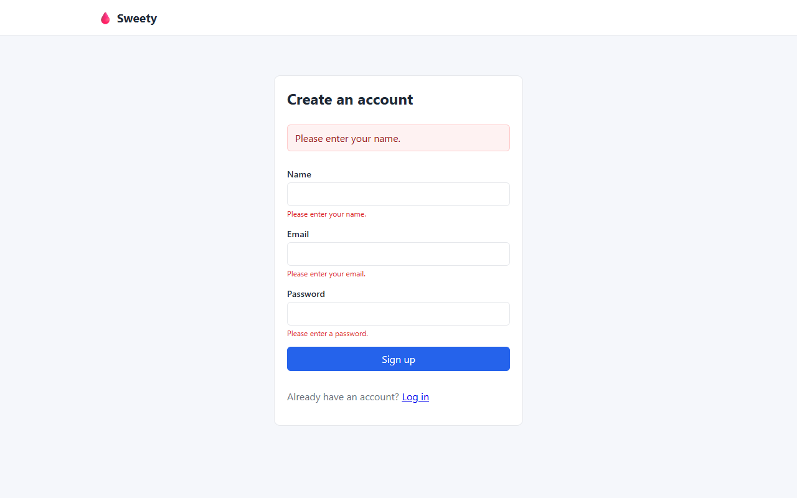 | New user, empty state 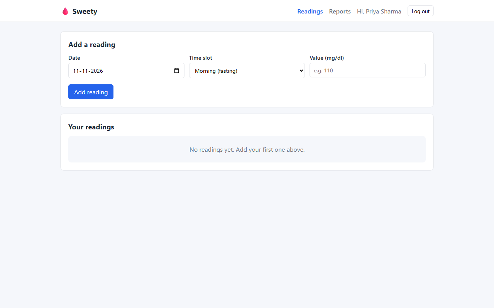 |
| Value required 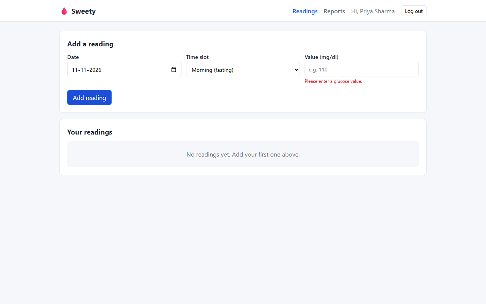 | Value out of range 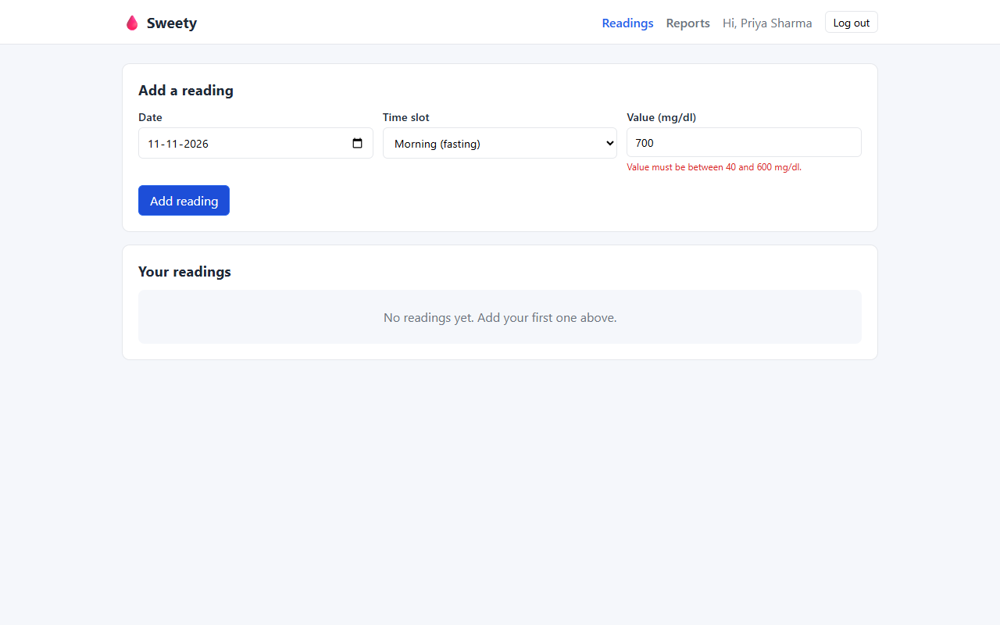 |
| Future date 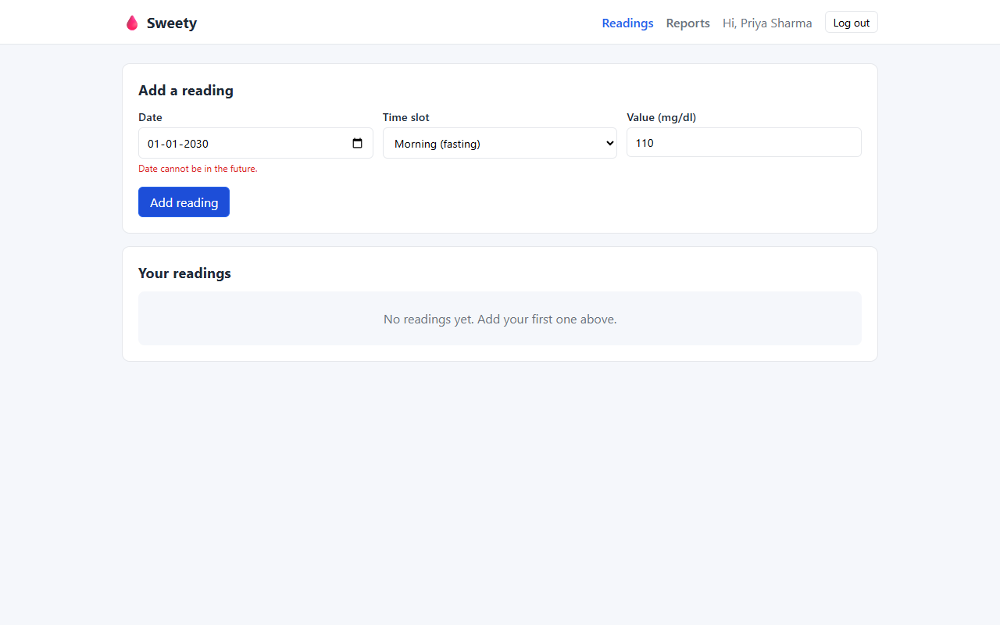 | One reading per slot per day 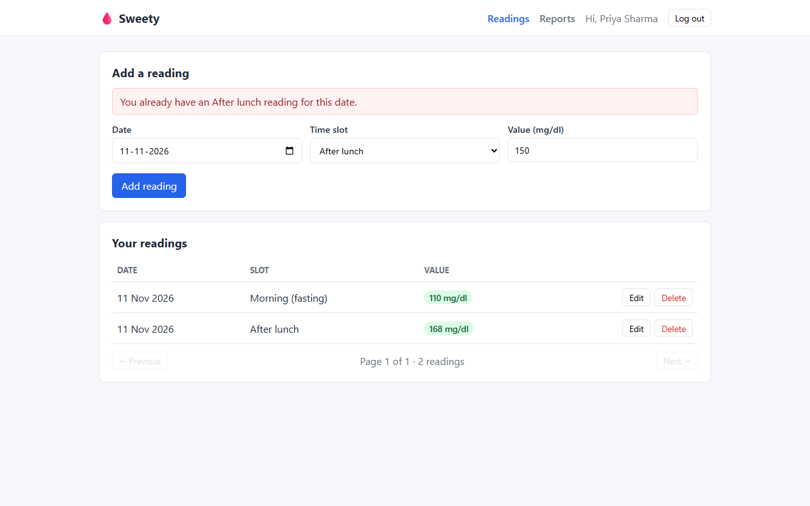 |
| Editing a reading 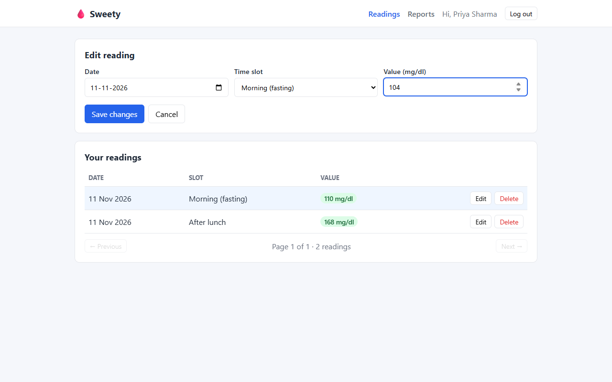 | Reports with empty states 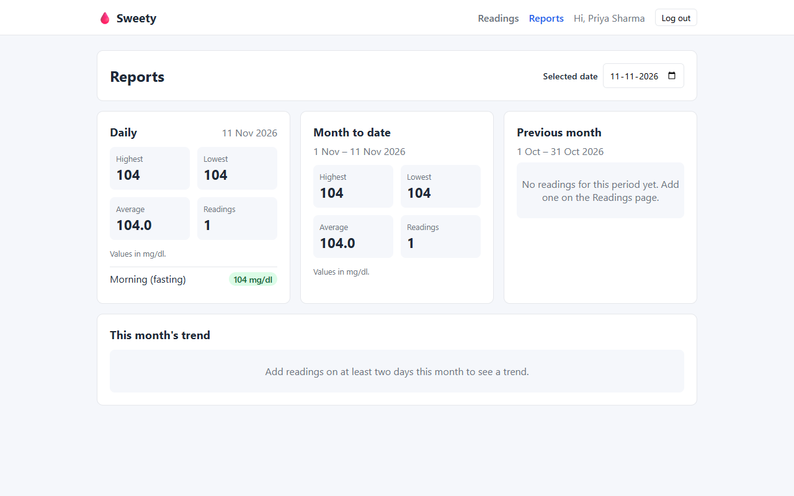 |
| Log in 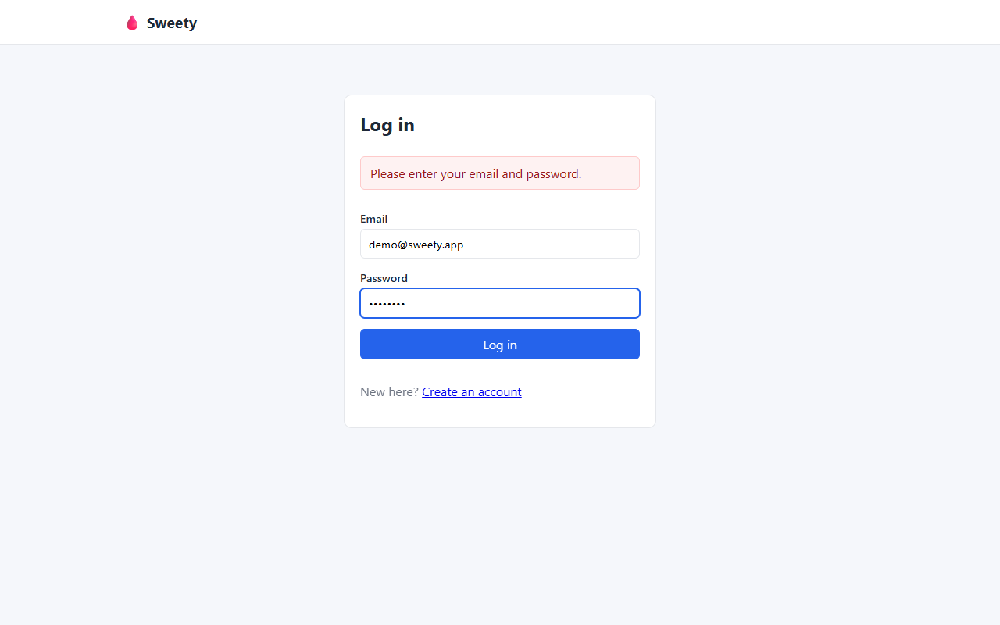 | Readings list with pagination 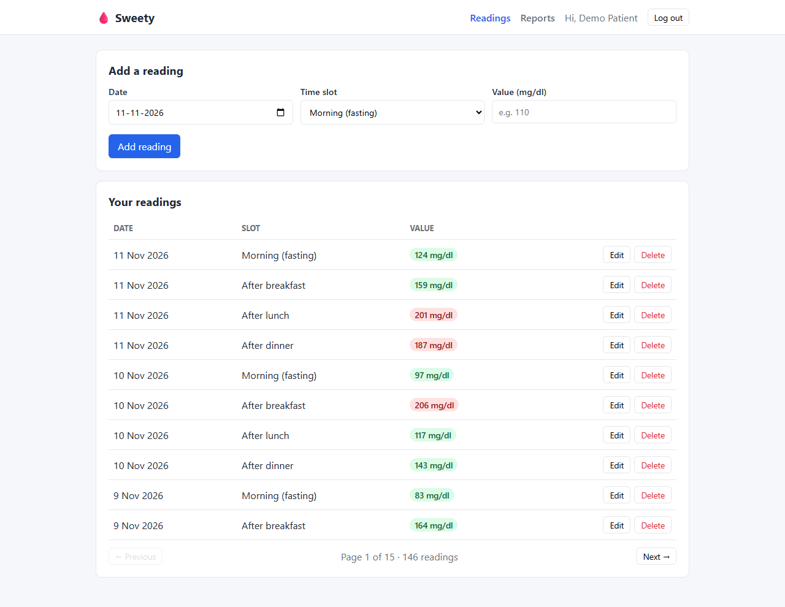 |
| Max 4 readings per day 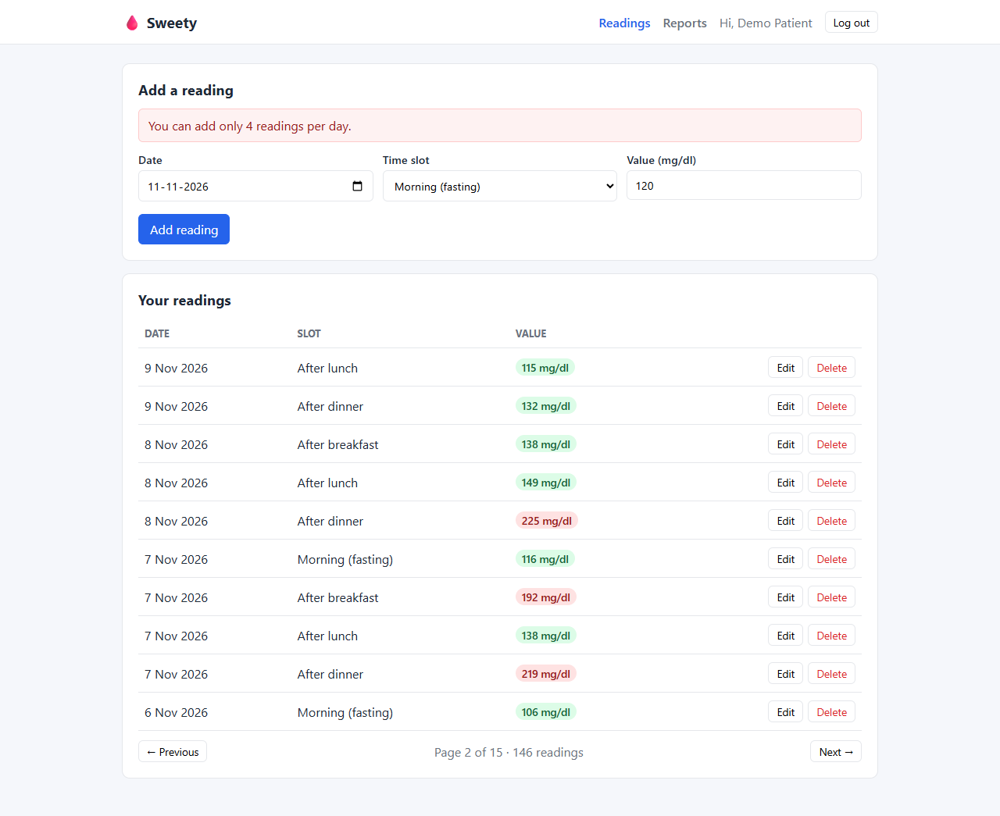 | Reports + month trend chart 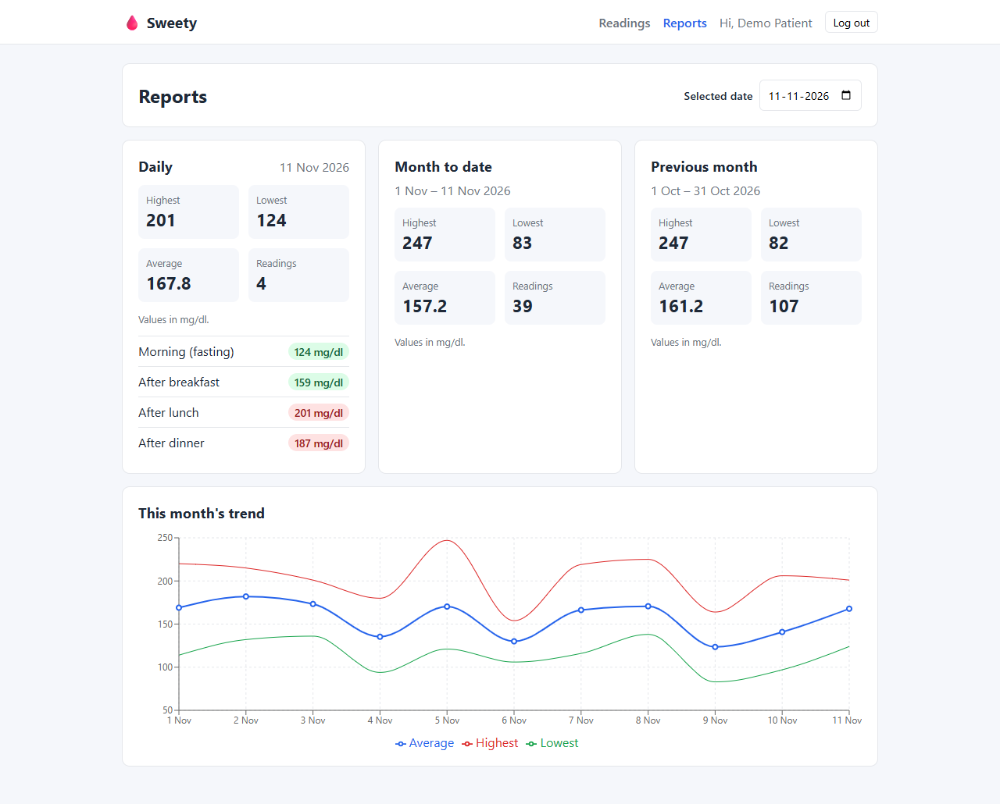 |
| Reports for another date 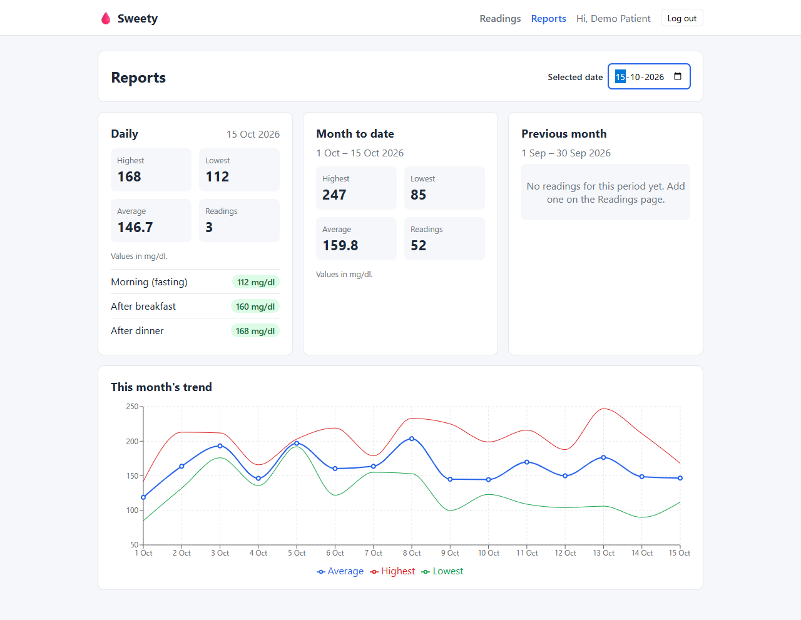 | |
